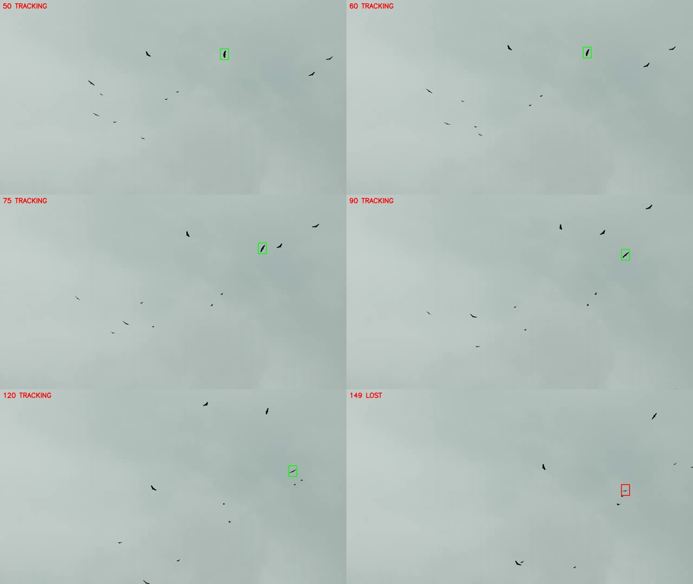

# Small-target identity diagnostic — 24 October 2026

Input: the user's local `/Users/apple/Downloads/video.mp4`, 1280x720, nominal
29.970 fps. This clip contains multiple small dark birds against a light sky.
There are no independent identity/visibility/box labels, so accuracy and identity
switch rate remain unmeasured.

The selected box can contain mostly sky. Similar sky/color statistics and a high
neural response alone cannot establish that the original bird remains inside it.
`compact_target.py` now detects suitable small, high-contrast selections and
associates observed foreground components using recent motion. It preserves the
selected box extent and never accepts an empty foreground patch. Ambiguous rivals,
possible merges, missing evidence, or source-frame gaps over 150 ms require a new
manual selection. A later similar bird cannot clear that loss.

This mode is limited to dark compact targets on a sufficiently light, smooth
background. It is not a classifier or a general reidentification solution. The
Python preview implementation has not been ported to the Pico native core.

## Actual clip checks

All three runs initialize at source frame 49. Diagnostic sheets show sampled
accepted observations and the first stopped observation. Visual inspection of
these samples does not replace continuous independent identity annotation.

| Initial x,y,width,height | Accepted frame range | First manual-reselection frame | Reason |
|---|---|---|---|
| 809,180,30,40 | 50–148 | 149 | Ambiguous nearby targets |
| 526,184,34,35 | 50–100 | 101 | Ambiguous nearby targets |
| 323,287,38,34 | 50–145 | 146 | Ambiguous nearby targets |



Additional sheets: [second selection](selection-526.jpg), [third selection](selection-323.jpg).

For the first selection, the sequential evaluator processed 494 decodable update
frames: 99 accepted, then 395 rejected. These are state/acceptance counts, not
accuracy percentages. `summary.json` explicitly reports accuracy as unmeasured.
The rejected period intentionally remains lost until the user selects again.

A local HTTP check initialized that selection and submitted 105 PNG frames through
the actual preview API. It accepted the first 99 updates, stopped at frame 149,
kept later updates rejected, and appended a trail break. The Birds sample endpoint
also passed a byte-range request. The temporary test session was reset afterward.

## Regression checks

Eight new checks cover measured silhouette translation, empty-background loss,
identical targets crossing/merging, frame gaps, duplicates, ambiguous selection,
reselection, and fallback for textured/large selections. All 54 Python tests and
11 JavaScript tests passed.

```sh
.venv/bin/python tools/benchmark_precision.py /Users/apple/Downloads/video.mp4 \
  --start-frame 49 --frames 498 --roi 809,180,30,40 \
  --output artifacts/birds-identity-current
.venv/bin/python -m unittest discover -s tests -p 'test_compact_target.py' -v
```

Reports: [summary](summary.json), [per-frame output](frames.jsonl),
[general neural-path diagnostic](neural-diagnostic.json).
