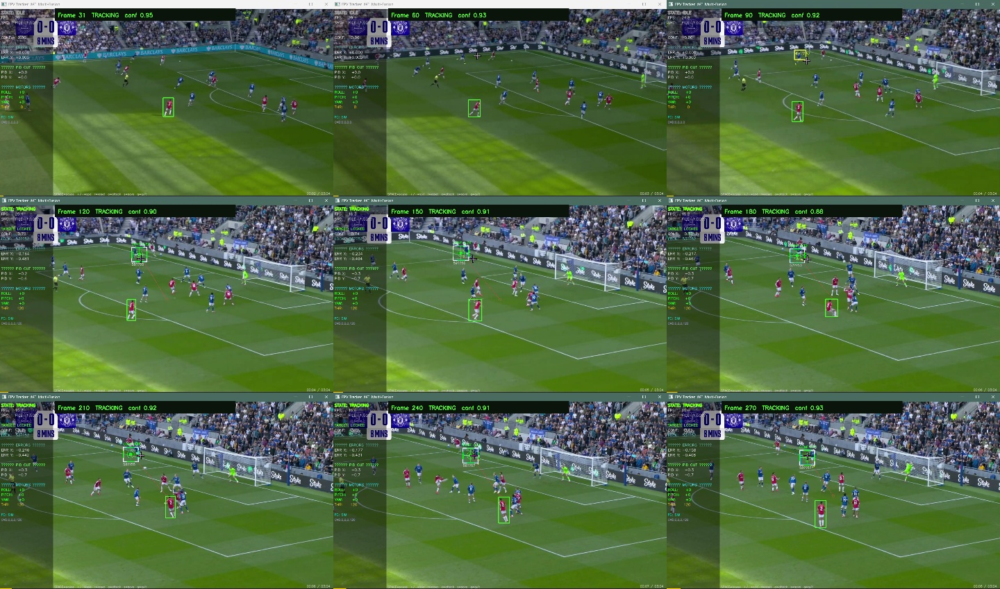
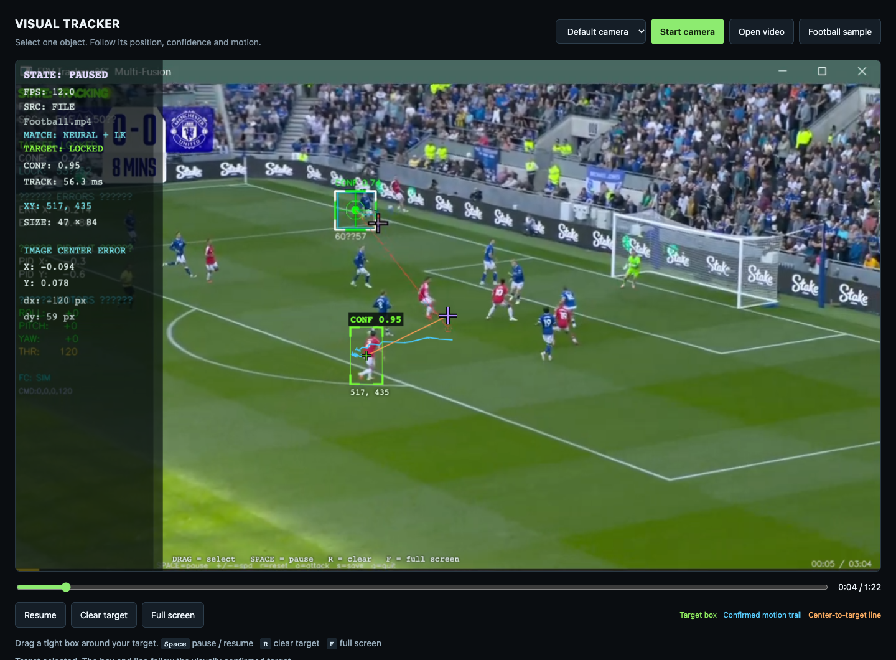

# Local football tracking comparison

Source: `/Users/apple/Downloads/Tracking Videos/Football.mp4`, 1274×752 at 30 FPS. A red-shirt player was manually selected at frame 30 with ROI `629,376,42,74`. Both offline runs processed frames 31–270 consecutively, an eight-second excerpt. Device: Intel Core i7-7567U, CPU inference with two OpenCV threads.

| Engine | TRACKING frames | WEAK frames | LOST frames |
|---|---:|---:|---:|
| Previous browser template baseline, 320×189 input | 4 | 7 | 229 |
| NanoTrack + forward/backward LK + appearance, native input | 239 | 1 | 0 |

These are emitted tracking states, **not an accuracy percentage**. No independently annotated bounding boxes were supplied. The sampled native output images were visually reviewed; the box remained on the selected red-shirt player in those samples. Full identity accuracy, IoU, and false-lock duration remain unmeasured for this clip.



The first native run averaged 17.4 ms per frame, with 19.8 ms at the 95th percentile. The reproducible artifact run, with other browser work on the laptop, averaged 33.1 ms with 69.6 ms at the 95th percentile. Timings vary with laptop load and exclude browser capture/encoding, local HTTP, decoding, and display.

A separate Chrome integration run using the actual football sample processed 101 updates: 100 TRACKING and one WEAK, with no page errors. The average media-time step was 36.4 ms, maximum 69.9 ms. Observed browser processing was about 12 FPS and the sampled request pipeline took 56.3 ms. File playback waits during processing; 12 processing FPS does not mean 30 FPS real-time playback. This is a laptop prototype result, not RV1106 performance.



## Loss handling checks

- Covering the selected player while retaining the surrounding scene produced LOST and no accepted measurement.
- Restoring the same target allowed appearance-based recovery after repeated confirmation.
- A camera cut from the close-up to the wide shot produced LOST and requested manual selection.
- Unit checks cover forward/backward flow on a known translation, missing-target rejection, immutable neural reference features, and scene-cut handling.

The interface keeps the last confirmed box when lost, breaks the trail on rejected evidence, and removes the current center-to-target line. Similar teammates and full occlusion can still make the target's identity uncertain.

Reproduce:

```sh
.venv/bin/python tools/benchmark_precision.py '/Users/apple/Downloads/Tracking Videos/Football.mp4' --start-frame 30 --frames 240 --roi 629,376,42,74 --output artifacts/football-neural
```

Raw outputs: [native summary](football-neural/summary.json), [per-frame results](football-neural/frames.jsonl), [previous baseline summary](football-baseline-summary.json), and [Chrome integration summary](football-neural-browser-summary.json).
