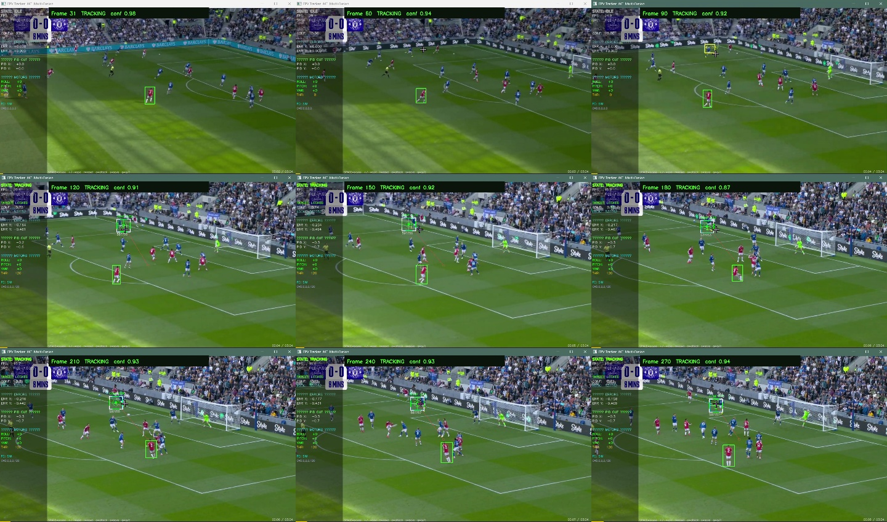

# Tracking recovery improvements — 23 October 2026

Implemented in the local browser/Python preview. The C++ RV1106 scaffold is separate. The 99% real-world accuracy target has not been established.

## Changes

- A frozen display frame and its decoded timestamp now define a selection, even while another frame is being processed. Stale requests and duplicate timestamps cannot replace selections or advance recovery.
- Forward/backward optical flow can preserve box shape and bridge short neural failures when spatially distributed features, texture, and original color agree.
- Missing evidence triggers a growing local reference search, with periodic whole-frame searches. Reacquisition requires three consistent observations. Distinct competing reference matches are rejected.
- Neural ambiguity compares decoded object boxes: response cells describing the same object no longer count as different targets.
- A sudden texture change is rejected for objects with previously stable texture. Saved references stay frozen during loss, and the original neural template is immutable.

## Generated diagnostic results

Exact generated ground truth, six deterministic sequences, 360 updates: 318 visible and 42 absent frames. Initialization is excluded. Visible success requires an accepted box with intersection-over-union (IoU) >= 0.5. Rejected visible frames are failures. These sequences were used during development; they are not a held-out benchmark and do not establish accuracy on camera footage.

| Measure | Before | After |
|---|---:|---:|
| Visible-frame success, IoU >= 0.5 | 86.79% | 98.74% |
| Visible-frame success, IoU >= 0.75 | 85.85% | 98.74% |
| Mean visible IoU, counting rejection as zero | 0.826 | 0.960 |
| False acceptance during absence | 12/42 | 0/42 |

| Sequence | Before: visible success | After: visible success |
|---|---:|---:|
| stationary | 100.00% | 100.00% |
| translation | 100.00% | 100.00% |
| fast_motion | 100.00% | 100.00% |
| scale | 100.00% | 100.00% |
| occlusion | 45.24% | 95.24% |
| distractor | 68.33% | 96.67% |

In the moving-occlusion case, the target was hidden for 30 frames while moving 6 pixels/frame. The baseline missed all 23 frames after reappearance. The revised tracker withheld confirmation for two visible frames, then recovered for the remaining 21. In the distractor case, the baseline falsely followed the distractor on all 12 hidden frames; the revised tracker rejected those frames and recovered the original target after confirmation.

## Real footage check

Football.mp4, initialization at frame 30, ROI 629,376,42,74, next 240 sequential frames: {'TRACKING': 240}. The nine sampled output images were visually reviewed and stayed on the selected red-shirt player. No independent frame-by-frame labels exist for this clip, so positional/identity accuracy remains unmeasured. Tracking state counts are not accuracy.



## Checks and reproduction

- 15 Python regression checks passed, including displaced recovery, distractor rejection, ambiguous candidates, duplicate frames, and evaluator denominators.
- 11 JavaScript checks passed (six preview/session regressions and five retained browser-baseline checks).
- The live HTTP API passed PNG initialization, ten generated translated-frame updates, and session reset. Browser race checks use a deterministic DOM harness; live camera capture was not exercised.

```sh
.venv/bin/python tools/benchmark_synthetic.py --baseline --output artifacts/synthetic-baseline
.venv/bin/python tools/benchmark_synthetic.py --output artifacts/synthetic-improved
.venv/bin/python tools/benchmark_precision.py '/Users/apple/Downloads/Tracking Videos/Football.mp4' --start-frame 30 --frames 240 --roi 629,376,42,74 --output artifacts/football-improved
.venv/bin/python -m unittest discover -s tests -p 'test_*.py' -v
node --test tests/native_preview.test.cjs tests/browser_tracker.test.cjs
```

Raw results: [baseline](synthetic-baseline/summary.json), [updated](synthetic-improved/summary.json), [football](football-improved/summary.json).

## Remaining limits

Reference matching works best when some distinctive appearance survives the occlusion. Large pose changes, blur, low texture, and indistinguishable objects can still cause loss or identity errors. Full-frame recovery adds processing cost while the target is lost. Three-frame confirmation intentionally delays acceptance. The displayed confidence is an uncalibrated evidence score.

To assess 99%, use representative videos with independent target boxes/visibility labels and a specified IoU threshold, false-lock tolerance, and latency budget. The evaluator supports these measurements and reports unmeasured values when labels are missing.
